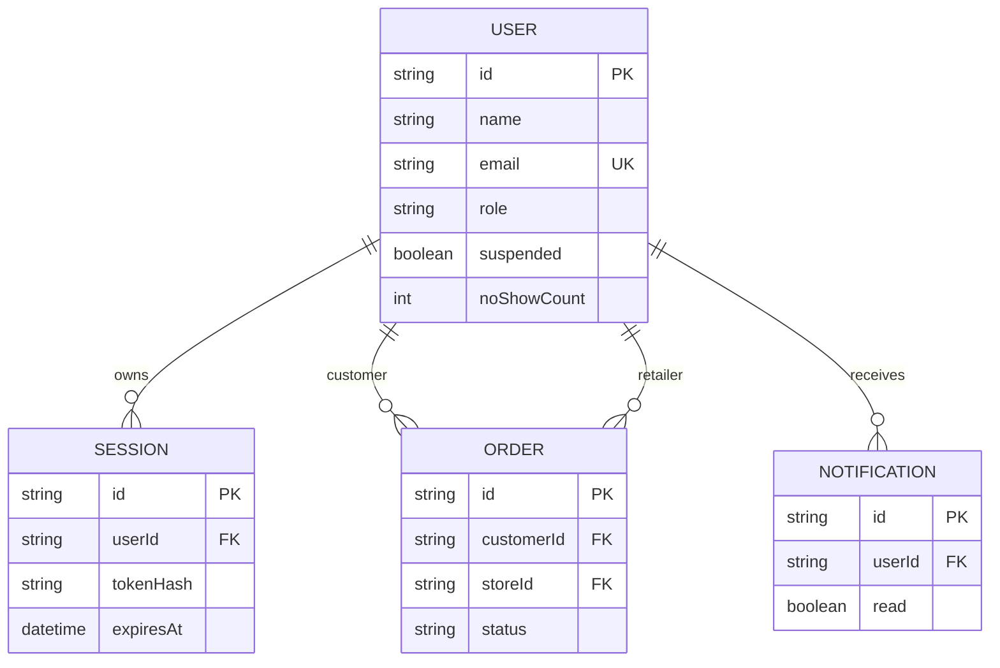

# PBI-03 — Skema Konseptual Manajemen Pengguna

`store`, `verification`, `favorites`, dan credential hash saat ini menjadi atribut akun yang
tertanam pada dokumen `USER`. Diagram ini model konseptual; aplikasi sekarang menyimpan tiap koleksi
sebagai JSON di tabel MySQL generik (`row_no`, `id`, `data`), bukan tabel relasional dengan foreign
key. Jika migrasi relasional dilakukan, `USER.id` menjadi acuan bagi `SESSION.userId`,
`ORDER.customerId`, `ORDER.storeId`, dan `NOTIFICATION.userId`.
