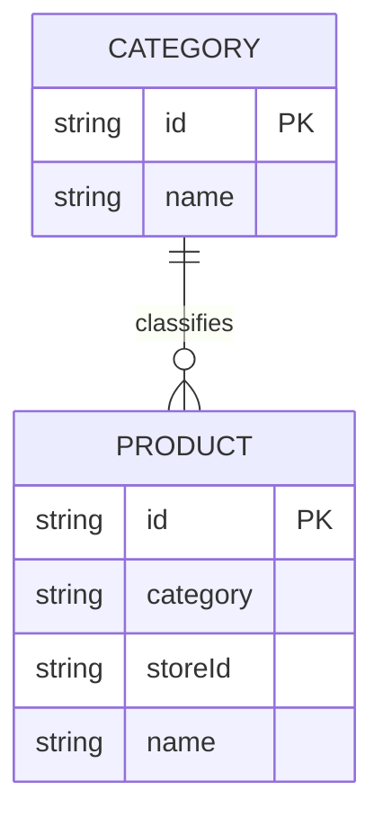

# PBI-04 — Skema Konseptual Kategori Produk

Hubungan kategori-produk saat ini bersifat logis: `PRODUCT.category` menyimpan nama kategori,
bukan `categoryId` dengan foreign key. Koleksi `categories` dan `products` tersimpan sebagai JSON
di tabel MySQL generik. Migrasi relasional sebaiknya menambah `PRODUCT.categoryId` dan menetapkan
kebijakan sebelum kategori yang masih dipakai dihapus.
