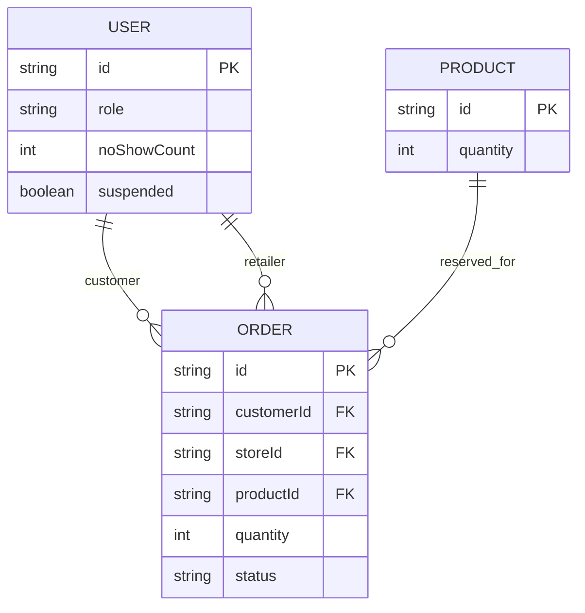

# PBI-20 — Skema Konseptual No-Show

No-show tidak menjadi entitas terpisah: event dicatat dengan mengubah `ORDER.status` menjadi
`No-show` dan menambah `USER.noShowCount`. Tabel tetap berbentuk koleksi JSON, sehingga relasi pada
diagram adalah konseptual dan tidak diberlakukan sebagai foreign key fisik.
